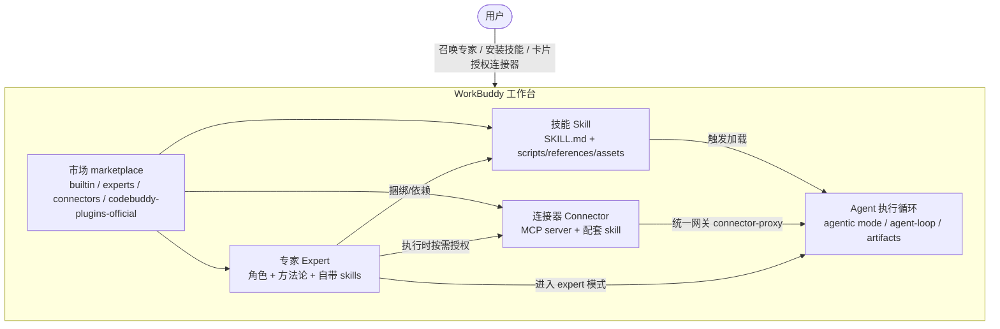

# WorkBuddy 的「专家 / 技能 / 连接器」分析

> 分析日期：2026-08-16
> 证据来源：腾讯云官方文档 + 本机 `/Applications/WorkBuddy.app`（app.asar 包结构）+ 本机 `~/.workbuddy/` 真实状态
> 结论性质：官方定义 = 官方文档原文；实测 = 本地包/目录结构证据；社区数据 = 第三方文章，随市场动态变化，未逐一核对

## 0. 结论先行

WorkBuddy（腾讯云 CodeBuddy 团队 2026-03 推出的系统级桌面 AI 工作台）的「专家 / 技能 / 连接器」三个东西，本质是**同一套「插件 + 市场（marketplace）」底座上的三种包类型**：

| 概念 | 一句话 | 本质 |
|---|---|---|
| **专家 Expert** | 特定领域的 AI 角色（Agent/Team） | 角色切换：人设 + 方法论 + 工具链 |
| **技能 Skill** | 可加载的具体能力包 | 让 AI "会做某件事" 的工具/流程 |
| **连接器 Connector** | 接外部服务的入口 | MCP 协议封装 + 授权 |

官方文档原话：**「Skill 是能力；专家是能力 + 经验；专家团是多位专家 + 协作流程。」**

本地扒包后确认：三者都以 `plugin.json + marketplace.json` 组织，存放在各自的 market 目录，运行时通过统一插件加载器消费。WorkBuddy 即 **CodeBuddy 的桌面化**，整套体系与 Codex 的 Skills / Agents / Apps(MCP) 高度同构。

## 1. 专家 Expert

### 官方定义

腾讯云文档《专家》：专家用于为 WorkBuddy 配置专业角色，在特定领域中以更明确的方法和视角完成任务。专家本身不主动获取系统权限，仅处理用户主动提供的对话与上传文件；配备 Skill / MCP 时才会在用户授权下间接访问文件或外部服务。

### 本地实测结构

来源：内置 `expert-manager` 技能 + 本机 `~/.workbuddy/plugins/marketplaces/experts/`：

```
experts/plugins/<专家名>/
├── .codebuddy-plugin/plugin.json   # 元数据 + 唯一标识
├── agents/<agentName>.md           # 专家人设/方法论正文（agentName = 文件名）
├── skills/                         # 该专家捆绑的技能（可选）
├── avatars/expert.png              # 头像
├── README.md / license/            # 说明与开源许可
```

### 关键机制

- **两种类型**：`expertType: "agent"`（单角色专家）和 `expertType: "team"`（专家团，多角色 + 团长拆解 + SOP 协作）。官方提示词确认专家团积分消耗约为单专家 3–5 倍。
- **展示字段**：`profession`（职业）、`displayName`（花名）、`expertType`、`categoryId`（行业分类）、`displayDescription`（能力介绍）、`tags`（固定 3 个擅长领域）、`quickPrompts`（3 个"试试这样问我"）、`defaultInitPrompt`、`avatar`、`members`（Team 型成员）——直接决定专家中心卡片呈现。
- **创建/管理工具链**：`init_expert.py` → `validate_expert.py` → `register_expert.py`（注册进 marketplace.json）→ `package_expert.py`；批量用 `batch_create.py`。
- **不可变标识**：`plugin.json` 的 `name`、`agentName`、专家目录名、`agents/*.md` 文件名是唯一标识，禁止修改（改名 = 重新创建）。
- **运行时行为**：切到专家后注入 `interactionmode-expert` 片段（agent-loop / tool-use / result-presentation），进入 **agentic 模式**：agent loop + artifact 目录 + `present_files` 交付。即"专家"不是简单换 prompt，而是升级整个执行模式。
- **本机实例**：已下载 `we-chat-mini-program-developer`（微信小程序开发专家），自带 5 个技能（fullstack-dev / impeccable / wechat-miniprogram / skyline / tdesign-miniprogram），带 Apache-2.0 / MIT 许可证。

## 2. 技能 Skill

### 官方定义

工具能力，让 AI 能做某件事（做 PPT、处理 PDF 等）。

### 本地实测结构

来源：内置 `skill-creator` 技能（与 Codex skill 规范几乎一字不差同源）：

```
skill-name/
├── SKILL.md            # YAML frontmatter(name/description) + Markdown 指令
├── scripts/            # 可执行代码（Python/Bash）
├── references/         # 按需加载进上下文的文档
└── assets/             # 产出物模板（不加载进上下文）
```

### 关键机制

- **三级渐进披露**：frontmatter 常驻上下文（~100 词）→ 命中时加载 SKILL.md 正文（<5k 词）→ 资源按需加载（无限）。目的是省上下文。
- **存放位置**：用户级 `~/.workbuddy/skills/<name>/` 或项目级 `.codebuddy/skills/<name>/`。
- **安装链路**：内置技能 `marketplace-skill-installer` 调宿主工具 `workbuddy_marketplace_skill`（search → install），安装到 `~/.workbuddy/skills/`；鉴权全部由宿主处理，模型禁止自己构造 HTTP。
- **本机内置 17 个技能**：设计类 ardot-*、金融类 wb-finance-skill、腾讯文档类 tencent-docs-routing / tencent-local-office-edit、`expert-manager`、`skill-creator`、`recommend-experts`、`recommend-connectors`、`library`、`marketplace-skill-installer`、`cloudstudio-deploy`、`geo-map-compliance-guard`、`buddy-multimodal-generation` 等。
- **本机插件市场** `codebuddy-plugins-official` 有 60+ 插件，大量与 Codex 生态同名同源：playwright-cli、github、pdf、pptx、xlsx、docx、frontend-design、find-skills、security-scan 等——直接证明 WorkBuddy/CodeBuddy 与 Codex 生态的互通性。

## 3. 连接器 Connector

### 官方定义

接通飞书、GitHub、腾讯文档等外部服务的入口；Enterprise 文档明确"运行时通过统一网关访问 MCP 工具"。

### 本地实测结构

来源：本机 `~/.workbuddy/connectors-marketplace/connectors/`：

```
connectors/<name>/
├── mcp.json      # MCP server 定义（如 linear-mcp: url: https://mcp.linear.app/mcp）
├── skills/       # 配套操作技能（SKILL.md）
└── cli.json      # CLI 型连接器（如钉钉、北森）
```

### 关键机制

- **技术底座就是 MCP**。市场里每种连接器 = 一个 MCP server（HTTP 远程或本地 CLI）+ 一个配套操作技能，教会模型怎么用。
- **已连接实例**：`~/.workbuddy/connectors/<uuid>/` 下有 `mcp.json` + `connector-states.v3.json`，凭据用 **AES-256-GCM + HKDF-SHA256** 加密存储（`.master.key`），不落明文。
- **统一网关**：`~/.workbuddy/.mcp.json` 暴露聚合代理 `connector-proxy`（如 `http://127.0.0.1:58047/mcp`），把已启用 MCP 聚合成一个入口给模型调用。
- **推荐/授权链路**（`recommend-connectors` 技能）：模型用 `search_plugins(type: "connector")` 搜索 → `suggest_plugin_install` 渲染连接器卡片 → **用户点击卡片触发安装/授权**；模型不得静默启用，不得用文字列表代替卡片。
- **本机市场清单**：ai-hive、cisp-mcp、dingtalk、finenter、cloudbase、baidu-netdisk、ezjoin-meeting、yzf-invoice-mcp-server、linear-mcp、beisen-cli、tencent-weiyun、kdocs 等；当前 `enabled: []`（已下载、未启用）。

## 4. 三者关系与协作链路



协作要点：

- 专家是"入口角色"，技能是它干活的手，连接器是它够到外部世界的接口。
- 权限边界分层收紧：专家本身无权 → 带 Skill 才间接碰文件 → 带 MCP 才碰外部服务；每个环节都是用户主动触发（召唤、安装、卡片授权）。
- 推荐是"被动助手"：模型只在任务确实需要且当前没有覆盖时才推荐，用户不点就不生效。

## 5. 与 Codex 体系对照

| WorkBuddy | Codex 对应物 | 差异点 |
|---|---|---|
| 技能 Skill | Skills（`SKILL.md`） | 几乎同源，规范一字不差 |
| 专家 Expert | Custom Agents / Specialists | WorkBuddy 把"角色"做成市场化的可分发插件包（头像/标签/推荐语/团队 SOP） |
| 专家团 Team | multi-agent 编排 | 做成公开市场商品，消耗 3–5 倍积分 |
| 连接器 Connector | Apps / MCP Connectors | 同为 MCP 底座 + 卡片式授权；WorkBuddy 统一走本地 `connector-proxy` 聚合网关 |
| 市场 marketplace | Plugins / Marketplace | `codebuddy-plugins-official` 大量插件与 Codex 生态同名同源 |

## 6. 对 DEX AI 助手（deecodex）可借鉴的点

1. **把"角色"商品化**：专家做成带展示元数据（职业/花名/标签/推荐语/头像）的可安装插件包，而非散落的 prompt 文件——`expert-manager` 的 `plugin.json + agents/*.md + skills/` 结构可直接作为插件规范蓝本。
2. **Skill 与 Connector 解耦但配套**：连接器 = MCP 配置 + 配套操作 Skill。这是"接上服务 ≠ 会用服务"的关键设计。
3. **权限与授权边界**：专家本身无权、Skill 才碰文件、MCP 才碰外部、授权必须用户卡片触发——与 DEX 助手"完全自动控制是产品目标但不是无限权限"的原则一致。

## 7. 证据来源与验证状态

- 官方定义：腾讯云 WorkBuddy Enterprise 文档（product/1831/134393）等。
- 结构/机制实测：`/Applications/WorkBuddy.app/Contents/Resources/app.asar` 内 marketplace.json、skill-creator、expert-manager、recommend-experts/connectors、interactionmode-expert、welcomemode prompt.tpl。
- 本机状态实测：`~/.workbuddy/` 下 connectors-marketplace、plugins/marketplaces/{experts,codebuddy-plugins-official,cb_teams_marketplace}、connectors/<uuid>/。
- 未验证项：专家/技能具体数量（官方自称 100+ 专家、社区报道 140+、技能 2 万+）随市场动态变化；连接器/专家的在线搜索结果与版本号未逐一核对。
