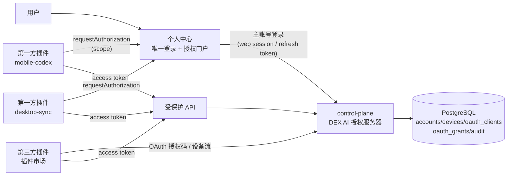
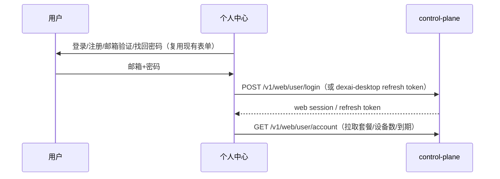
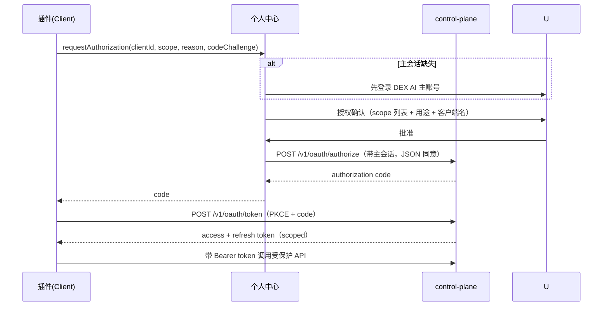

# DEX AI 统一账号与授权中心设计（个人中心为唯一登录入口）

> 状态：设计稿 v0.9（Phase 0/1a/1b/2a/2b 完成；control-plane 已部署上线，OAuth/OIDC/审计端点公网可用）
> 范围：control-plane（DEX AI 主账号 / 授权服务器）+ deecodex-gui 个人中心（登录与授权门户）+ 插件体系（授权客户端）

## 1. 背景与目标

当前每个需要"登录"的插件/功能各自维护账号与登录 UI（如 deecodex-mobile-codex 在个人中心和插件详情页各有一套邮箱密码登录）。随着 DEX AI 能力扩张，这会导致：

- 用户要在不同插件里重复登录，账号体系分裂。
- 插件各自保存密码/凭证，安全边界不统一。
- 无法统一审计、统一撤销、统一设备门禁。

目标：**个人中心是 DEX AI 唯一登录入口；所有插件与未来功能不再自行登录，而是向个人中心申请授权（scope），由个人中心审批后发放可撤销的授权令牌。**

## 2. 已确认决策（Decision Records）

| # | 决策 | 结论 |
|---|------|------|
| D1 | 主账号体系 | 把 control-plane 账号体系升级为 **DEX AI 主账号**（不新建独立账号系统） |
| D2 | 授权中心位置 | **上云端**：授权令牌由 control-plane 服务端签发/校验/撤销，个人中心只做登录与审批门户 |
| D3 | 开放范围 | 插件市场**第三方插件也可申请授权**，协议按 **OAuth 2.0 / OIDC** 设计 |

## 3. 术语与角色

| 术语 | 说明 |
|------|------|
| DEX AI 主账号 | 由 control-plane `accounts` 升级而来，是用户在 DEX AI 的唯一身份（邮箱+密码+验证+套餐+设备） |
| 授权服务器（AS） | control-plane，负责账号认证、OAuth 授权码/token 签发、撤销、JWKS |
| 个人中心 | deecodex-gui 的个人中心面板：唯一登录入口 + 授权审批门户 + 授权管理/撤销页 |
| 插件/功能（Client） | 需要访问受保护能力的实体：第一方（mobile-codex、desktop-sync…）与第三方（插件市场） |
| 授权（Grant） | 用户批准某 Client 以某 scope 访问某资源的记录；可撤销、可审计 |
| 资源服务 | control-plane 现有受保护 API（设备、网络凭证、服务状态…），统一改为校验 OAuth access token |

## 4. 总体架构



关键原则：

1. **登录只发生在个人中心**：主账号密码只经个人中心进入系统，插件不接触密码。
2. **插件只持有授权，不持有登录**：插件拿到的是 scoped access/refresh token，且随时可被个人中心撤销。
3. **令牌由云端签发**：换电脑/重装后 token 可重新获取，不依赖本机凭证目录。
4. **标准协议**：第三方走 OAuth 2.0 / OIDC，第一方走同一协议但由个人中心做审批门户。

## 5. 身份模型：DEX AI 主账号（control-plane 升级）

### 现状（已存在，直接复用）

- `accounts`：email（唯一）、Argon2 密码哈希、邮箱验证、`service_status`、`billing_plan_code`、`subscription_expires_at`、设备上限（`billing_plans.device_limit` / `device_limit_override`）。
- `invitations`：邀请码注册（含套餐与服务天数）。
- `devices`：移动/电脑设备、公钥、硬件指纹、撤销、设备凭证（`credential_hash`）。
- `refresh_sessions`：refresh token 家族 + 轮换 + 复用检测（`replaced_by`、`used_at`）。
- `computer_enrollments`：电脑绑定 QR + 审批 + 轮询（已有的"反向设备授权"）。
- `audit_events`：账号/设备/动作/结果审计。
- JWT：Ed25519 签名，`AccessClaims{iss,sub,device_id,scope,iat,exp,jti}`、`SessionClaims{...,scopes}`，`/v1/auth/jwks` 暴露公钥。
- Web 会话：`web_sessions`（cookie + CSRF + 同源校验），web 控制台已具备用户/管理员登录。

### 升级点

- 品牌/语义：control-plane 承担 **DEX AI 身份与授权服务器** 角色（`iss` 可保持 `mobile-codex` 或新增 `dexai`，迁移期两值都接受）。
- 账号仍以"邀请码注册 → 邮箱验证 → 登录"为主，不需要新增账号表。
- 在 `accounts` 上无破坏性变更；新增 OAuth 相关表（见 §8）。

## 6. 授权模型：OAuth 2.0 / OIDC + scope 目录

### 6.1 客户端类型

| 客户端 | client_id 示例 | 认证方式 | 说明 |
|--------|---------------|----------|------|
| 第一方桌面 | `dexai-desktop` | 机密（secret 存系统钥匙串）+ PKCE | 个人中心自身，持有主会话 |
| 第一方插件 | `dexai-mobile-codex`、`dexai-desktop-sync` | PKCE（公开）+ 首方白名单 | 插件向个人中心申请授权 |
| 第三方插件 | 注册时分配（如 `plugin-xxxxxxxx`） | 机密/公开按场景 | 插件市场开发者注册获得 |

### 6.2 scope 目录（初版）

| scope | 含义 | 初版授予对象 |
|-------|------|--------------|
| `openid profile email` | OIDC 身份信息（可选） | 所有客户端 |
| `dexai:profile.read` | 读取主账号基本信息 | 个人中心、第一方 |
| `mobile-codex:service` | 启动/停止 Companion 服务 | deecodex-mobile-codex |
| `mobile-codex:devices` | 设备列表/重命名/撤销 | deecodex-mobile-codex |
| `mobile-codex:p2p` | 网络凭证 / Tailnet 入网 | deecodex-mobile-codex |
| `sync:threads.read` / `sync:threads.write` | 桌面线程同步 | deecodex-desktop-sync |
| `telemetry:write` | 匿名统计上报 | 第一方、经审批的第三方 |
| `dex:assistant.tools` | DEX 助手工具调用（预留） | 插件市场第三方 |

规则：

- scope 为空格分隔字符串，服务端按 **客户端白名单** 校验，未注册 scope 直接拒绝。
- 客户端 manifest 声明需要的 scope 与用途（reason），个人中心审批页展示给用户。
- 每个"账号 × 客户端 × scope 集合"产生一条可撤销的授权记录（`oauth_consents`）。

### 6.3 Token 模型

- **access token**：JWT（复用现有 Ed25519 签名与 JWKS），新增 `client_id`、`token_type=oauth`、`aud`、空格分隔 `scope`；短时（建议沿用 600s）。
- **refresh token**：不透明随机串（沿用 `token_hash` 存储），绑定 `account_id + client_id + scopes`，长期（建议 30 天），**每次轮换、可撤销、可复用检测**（复用现有 `refresh_sessions` 的轮换逻辑）。
- **与设备凭证隔离**：OAuth token 管"应用/插件"权限；`device_credential` 管"设备/P2P 身份"，两套互相不越权。
- 旧 access token（`scope=device_type`，无 `client_id`）在迁移期内继续有效，视为 `device` 型 token；新 token 一律带 `token_type`。

## 7. 流程设计

### 7.1 主账号登录（只在个人中心）



- 个人中心持有主会话（cookie 或 `dexai-desktop` 客户端 refresh token），是后续一切授权的基座。
- 现有"Mobile Codex 账号"区的邮箱密码登录收敛为"登录 DEX AI 主账号"，不再单独注册 Mobile Codex 账号。

### 7.2 插件授权（第一方，个人中心审批门户）



- 个人中心只做**审批中介**，不代持插件的 token；token 直接发给客户端。
- 强制 PKCE，第一方插件也走，避免 code 被本机其他进程劫持。

### 7.3 第三方插件授权（标准 OAuth）

- 有浏览器的场景：标准 **Authorization Code + PKCE**，`GET /v1/oauth/authorize`（302 重定向到 web 控制台同意页）→ 回调插件 `redirect_uri`。
- 无浏览器/桌面场景：**Device Flow（RFC 8628）**：插件拿 `device_code`，个人中心或 web 控制台输入/展示用户码并同意。
- 插件市场安装页展示"需要授权：scope 列表"，未授权前不可运行。

### 7.4 撤销与审计

- 个人中心新增"已授权应用/插件"页：展示客户端、scope、授予时间、最后使用，支持**一键撤销**（撤销 refresh token 家族 + 置 `oauth_consents.status=revoked` + 写 `audit_events`）。
- 撤销当前设备的插件授权后，插件下次调用即 401，个人中心提示重新授权。
- 所有 OAuth 动作写 `audit_events`：`client_id`、`account_id`、`scope`、`action(issue/revoke/refresh)`、`outcome`。

## 8. control-plane 新增内容

### 8.1 数据库迁移（草案）

```sql
CREATE TABLE oauth_clients (
    id UUID PRIMARY KEY,
    client_id TEXT NOT NULL UNIQUE,
    client_secret_hash BYTEA,              -- 机密客户端才有
    name TEXT NOT NULL,
    first_party BOOLEAN NOT NULL DEFAULT FALSE,
    redirect_uris JSONB NOT NULL DEFAULT '[]'::jsonb,
    scopes JSONB NOT NULL DEFAULT '[]'::jsonb,   -- 允许的 scope 白名单
    is_active BOOLEAN NOT NULL DEFAULT TRUE,
    created_at TIMESTAMPTZ NOT NULL DEFAULT NOW()
);

CREATE TABLE oauth_consents (
    id UUID PRIMARY KEY,
    account_id UUID NOT NULL REFERENCES accounts(id) ON DELETE CASCADE,
    client_id UUID NOT NULL REFERENCES oauth_clients(id) ON DELETE CASCADE,
    scopes JSONB NOT NULL,
    status TEXT NOT NULL DEFAULT 'active' CHECK (status IN ('active','revoked')),
    revoked_at TIMESTAMPTZ,
    created_at TIMESTAMPTZ NOT NULL DEFAULT NOW(),
    UNIQUE (account_id, client_id)
);

CREATE TABLE oauth_authorization_codes (
    id UUID PRIMARY KEY,
    code_hash BYTEA NOT NULL UNIQUE,
    account_id UUID NOT NULL REFERENCES accounts(id) ON DELETE CASCADE,
    client_id UUID NOT NULL REFERENCES oauth_clients(id) ON DELETE CASCADE,
    scopes JSONB NOT NULL,
    code_challenge TEXT,
    code_challenge_method TEXT,
    redirect_uri TEXT NOT NULL,
    expires_at TIMESTAMPTZ NOT NULL,
    consumed_at TIMESTAMPTZ,
    created_at TIMESTAMPTZ NOT NULL DEFAULT NOW()
);

CREATE TABLE oauth_refresh_sessions (
    id UUID PRIMARY KEY,
    family_id UUID NOT NULL,
    account_id UUID NOT NULL REFERENCES accounts(id) ON DELETE CASCADE,
    client_id UUID NOT NULL REFERENCES oauth_clients(id) ON DELETE CASCADE,
    scopes JSONB NOT NULL,
    token_hash BYTEA NOT NULL UNIQUE,
    expires_at TIMESTAMPTZ NOT NULL,
    used_at TIMESTAMPTZ,
    revoked_at TIMESTAMPTZ,
    replaced_by UUID REFERENCES oauth_refresh_sessions(id),
    created_at TIMESTAMPTZ NOT NULL DEFAULT NOW()
);
CREATE INDEX oauth_refresh_sessions_family_idx ON oauth_refresh_sessions(family_id);

ALTER TABLE audit_events ADD COLUMN client_id UUID REFERENCES oauth_clients(id) ON DELETE SET NULL;
```

### 8.2 新增接口

**OAuth 核心：**

| 方法 | 路径 | 说明 |
|------|------|------|
| GET | `/v1/oauth/authorize` | 浏览器授权（302 同意页 / 回调） |
| POST | `/v1/oauth/authorize` | JSON 同意（个人中心带主会话调用） |
| POST | `/v1/oauth/token` | 换 token（授权码/PKCE、refresh、device） |
| POST | `/v1/oauth/revoke` | 撤销 refresh token |
| GET | `/v1/oauth/userinfo` | OIDC 用户信息 |
| GET | `/v1/oauth/.well-known/openid-configuration` | OIDC 发现 |
| POST | `/v1/oauth/device` | 设备流：申请 device_code / 轮询 |

**授权管理（个人中心/用户）：**

| 方法 | 路径 | 说明 |
|------|------|------|
| GET | `/v1/oauth/grants` | 我的已授权客户端列表 |
| POST | `/v1/oauth/grants/{id}/revoke` | 撤销指定授权 |

**管理端（开发者/管理员）：**

| 方法 | 路径 | 说明 |
|------|------|------|
| POST | `/v1/admin/oauth/clients` | 注册客户端（第一方/第三方） |
| GET | `/v1/admin/oauth/clients` | 列表 |
| PATCH/DELETE | `/v1/admin/oauth/clients/{id}` | 更新/停用 |

### 8.3 受保护 API 改造

- 现有需要 `Bearer` 的端点（`/v1/devices`、`/v1/network/credentials`、`/v1/account` 等）统一走一个 middleware：解析 JWT → 校验 `token_type` + `client_id` + `scope`。
- `scope` 缺失/不足返回 403 + 所需 scope，方便客户端引导用户补授权。

## 9. deecodex-gui 个人中心改动

1. **主账号登录区**：把现有"Mobile Codex 账号"升级为"DEX AI 主账号"（登录/注册/验证/找回/重置复用现有表单与桥接，但语义改为主账号）。
2. **授权审批**：新增 Tauri 命令 `request_plugin_authorization(clientId, scope, reason, codeChallenge)`，个人中心展示授权确认卡片并调用 `POST /v1/oauth/authorize`。
3. **授权管理页**：新增"已授权应用/插件"列表（客户端、scope、时间、状态），支持撤销；与账号信息/设备管理并列。
4. **插件 manifest 扩展**：插件声明所需授权：

```json
{
  "auth": {
    "client_id": "dexai-mobile-codex",
    "scopes": ["mobile-codex:service", "mobile-codex:devices", "mobile-codex:p2p"],
    "reason": "管理本机 Companion 与绑定设备",
    "first_party": true
  }
}
```

5. **插件 SDK（JS 侧）**：统一 `requestGrant(clientId, scopes, reason)` → 走个人中心审批 → 返回 access/refresh token；token 由插件进程保管，前端只触发审批。

## 10. 迁移与兼容

- 保留现有 `/v1/auth/login` 与设备登录流（手机端不变）；电脑端插件从"密码登录"平滑迁移到"个人中心授权"，迁移期内两种都可用。
- 旧 access token（`scope=device_type`）在过期前继续有效；`/v1/auth/jwks` 不变。
- 现有 `deecodex-mobile-codex` 的 `account.methods`（register/login/…）保留为兼容层，但 UI 层不再暴露单独登录；注册/找回等动作迁到主账号。
- web 控制台（用户/管理员）登录不受影响，作为 OAuth 同意页的浏览器宿主。

## 11. 分阶段实施计划

### Phase 0：control-plane OAuth 底座（✅ 已实现）

- [x] 迁移 `0006_oauth.sql`：`oauth_clients` / `oauth_consents` / `oauth_authorization_codes` / `oauth_refresh_sessions` / `oauth_device_codes` + `audit_events.client_id`，并内置第一方客户端种子（`dexai-desktop`、`dexai-mobile-codex`）
- [x] 客户端注册/管理 admin API（`/v1/admin/oauth/clients` GET/POST/PATCH/DELETE，机密客户端一次性回显 secret）
- [x] `/v1/oauth/authorize`（GET 浏览器同意页 + POST JSON 个人中心审批）、`/v1/oauth/token`（authorization_code + refresh_token + device_code）、`/v1/oauth/revoke`、`/v1/oauth/userinfo` + PKCE（S256/plain）+ scope 白名单校验
- [x] 设备流（RFC 8628）：`/v1/oauth/device`、`/v1/oauth/device/poll`、`/v1/oauth/device/approve`
- [x] 授权管理：`/v1/oauth/grants`、`/v1/oauth/grants/{id}/revoke`（撤销授权连带撤销该客户端 refresh 家族）
- [x] OAuth 资源访问 helper `authorize_oauth_token`（校验 `token_type=oauth` + 客户端启用），用于 userinfo/grants
- [x] `AccessClaims` 扩展 `client_id` / `aud` / `token_type` / `device_id` 可空；新增 `issue_oauth_access`，旧 device token 双轨兼容
- [x] 集成测试 `oauth_clients_codes_refresh_and_device_flow`：种子客户端、授权码一次使用、refresh 轮换/复用检测/撤销、授权撤销连带失效、设备流申请→批准→消费、审计带 client_id
- [x] 集成测试改为串行（`--test-threads=1`），避免共享测试库并发 TRUNCATE 互相干扰

> 边界说明：Phase 0 的 OAuth scope 校验（`authorize_oauth_token`）先作用于新增的 OAuth 资源端点（userinfo/grants）；存量设备 API（`/v1/devices`、`/v1/network/credentials` 等）仍走设备 token，保持零回归。存量设备 API 的 scope 化迁移放在 Phase 1，随 deecodex-mobile-codex 插件切换时一并完成。

### Phase 1：个人中心收敛

#### Phase 1a（✅ 已实现）

- [x] control-plane 新增 `grant_type=password`（仅第一方客户端，桌面主账号登录；含邮箱验证/服务可用性校验）
- [x] control-plane `/v1/oauth/authorize`（POST）接受 OAuth Bearer（`dexai:consent`），桌面个人中心可代为审批
- [x] control-plane `/v1/oauth/grants` + 撤销接受 OAuth Bearer（`dexai:grants`）
- [x] `dexai-desktop` 种子 scope 增加 `dexai:consent`、`dexai:grants`
- [x] control-plane HTTP 冒烟 13 项全过：password grant → userinfo → authorize(Bearer) → PKCE 换 token → grants 列表/撤销 → 撤销后 refresh 失效 → 无 token 401 → 无 scope 403
- [x] deecodex-gui 新增 `dex_account` 命令：`dexai_master_login/status/logout`、`dexai_oauth_authorize/grants/revoke_grant`；主会话（refresh token）落盘 data_dir（0600）
- [x] 个人中心 UI：DEX AI 主账号登录区 + 已登录账号卡片 + 授权管理（已授权应用列表/撤销）+ 授权插件（PKCE 生成授权码）
- [x] `profile-render-smoke.test.js` 覆盖主账号登录/授权管理/授权链路；`cargo build` + node 测试通过；浏览器 mock 实测两状态渲染与授权码生成

#### Phase 1b（✅ 已实现：插件 OAuth 采用）

- [x] control-plane：设备/账号管理 API（`/v1/devices`、`/v1/devices/{id}` rename/revoke、`/v1/account`）新增 `authorize_account_or_oauth`，接受 OAuth token（`mobile-codex:devices` scope），Device 凭证向后兼容
- [x] control-plane：OAuth token 校验增加 **consent 活动性检查**——撤销授权后已签发 access token 立即 401（不再有 600s 宽限期）
- [x] control-plane：`grant_type=password` 为主账号客户端 `dexai-desktop` 建立 consent，纳入可撤销授权管理
- [x] companion `cloud.rs`：新增 `oauth_exchange`（授权码+PKCE）、`oauth_refresh`（轮换）、`oauth_revoke`、`is_oauth_grant_revoked`
- [x] companion `secret.rs`：新增 OAuth refresh token/scopes 独立凭证存储（与账号登录凭证分离）
- [x] companion `dex_plugin.rs`：新增 `mobile_codex.oauth.exchange/status/logout`；设备/账号管理调用优先 OAuth token（`oauth_management_token` 自动轮换、撤销后回退账号登录）；P2P 数据面（网络凭证）仍走设备凭证
- [x] deecodex-gui：新增通用 `invoke_plugin_rpc` 命令；个人中心“授权 Mobile Codex 插件”按钮闭环：授权码 → 插件 exchange → 显示 OAuth 授权状态；撤销 mobile-codex 授权时同步通知插件 `oauth.logout`
- [x] 验证：control-plane 集成测试 + HTTP 冒烟 11 项（插件 OAuth 列设备/读账号 200、P2P 边界拒绝、设备凭证兼容、撤销后即时 401、refresh 失效）；companion 328 单测；deecodex cargo build + node 测试；浏览器闭环 mock

> 边界：OAuth 管“账号/设备管理面”，设备凭证继续管“P2P/数据面”——两套互相不越权，符合设计 §6.3。

### Phase 2：协议化与多插件接入

#### Phase 2a（✅ 已实现）

- [x] control-plane：`/.well-known/openid-configuration`（RFC 8414 子集：issuer/authorize/token/userinfo/jwks、scope/grant/PKCE 支持列表）+ 单测
- [x] 插件 SDK 化第一层：`PluginManifest`/`PluginInfo` 增加 `auth` 声明块（client_id/scopes/reason/redirect_uri + exchange/status/logout 方法）；`dexai_plugin_auth_manifest` 命令透出
- [x] 个人中心“可授权插件”按声明通用渲染（名称/用途/scope/状态 + 授权/重新授权）；授权流按插件声明的 exchange 方法执行；撤销时按声明调用 logout
- [x] 验证：control-plane 26 单测 + 集成；deecodex-plugins 38 单测；deecodex-gui build + node 测试；浏览器 mock 两插件按声明渲染

#### Phase 2b（待做）

- [x] 授权审计落地：OAuth 授权/换令牌/刷新/设备流/主账号登录/撤销均写 `audit_events`（含 client_id 与 request_id）
- [x] 审计查询：`GET /v1/oauth/audit`（按账号、LEFT JOIN 客户端名）
- [x] 个人中心“最近授权记录”可视化（动作/客户端/结果/时间）
- [x] 管理后台审计：`GET /v1/admin/audit`（admin 认证，按动作/客户端/limit 过滤，LEFT JOIN 账号邮箱与客户端名）
- [x] 401 重授权引导：插件授权被撤销时个人中心显示“需重新授权”（amber），区分“未授权”
- [x] 审计导出：`/v1/admin/audit/export`（管理后台 CSV）与 `/v1/oauth/audit/export`（个人中心 CSV）
- [ ] desktop-sync、WorkBuddy 等第一方插件补齐 `auth` 声明与 OAuth exchange 实现（各插件进程侧）
- [ ] 插件 SDK 固化（token 保管规范 / 401 自动重授权引导 / `requestGrant` 统一入口）
- [ ] web 控制台审计页面（当前仓库无控制台前端，需要独立前端项目接入）

### Phase 3：第三方开放

- [ ] 第三方开发者注册门户（client_id/secret 自助申请 + scope 审批）
- [ ] 插件市场安装页授权门禁
- [ ] 标准浏览器授权/设备流端到端验收

## 12. 安全与风险

- 客户端密钥：第一方 secret 存系统钥匙串；第三方 secret 只发给开发者，服务端只存哈希。
- 强制 PKCE（第一方也不例外）；authorization code 一次使用、短时（60s）。
- refresh token 轮换 + 复用检测（复用现有实现思路）+ 可撤销。
- scope 最小化：客户端白名单 + 用户可见同意；撤销即全家族失效。
- 限流：沿用现有 SimpleRateLimiter，为 OAuth 端点增加独立 key。
- 兼容风险：OAuth middleware 上线初期对旧 token 双轨校验，灰度放量。
- 密钥轮换：沿用 JWK `kid`，支持多密钥并存。

## 13. 验收标准

1. 用户在个人中心登录一次主账号，可在任意已授权插件间切换，无需重复登录。
2. 插件首次请求授权时个人中心显示 scope/用途，批准后插件获得 scoped token。
3. 个人中心撤销某插件授权后，该插件所有会话立即失效（401），重新授权后可恢复。
4. 第三方插件按标准 OAuth 授权码+PKCE / 设备流完成接入，无需改个人中心代码。
5. 旧设备/旧 token 在迁移期内不受影响；web 控制台功能不回归。
6. 所有授权动作有审计记录（账号/客户端/scope/动作/结果）。

## 14. 待定项（评审时确认）

- scope 命名最终定稿：`dexai:*` vs `mobile-codex:*` 前缀；是否引入 OIDC `openid profile email`。
- access/refresh token 时长（建议沿用 600s / 30d）。
- 同意页宿主：个人中心内自绘（推荐）vs web 控制台页面。
- 第三方开发者门户形态与审核流程（Phase 3）。
- 文档归属：建议 control-plane 仓库复制维护一份权威版本。

## 15. 生产部署状态（2026-08-16）

- 生产目标：`<DEPLOY_HOST>`，systemd `mobile-codex-control-plane`，监听 `127.0.0.1:8182`，Nginx 对外（`api.liguan.me/mobile-codex/`）。
- 已部署：迁移 `0006_oauth.sql`（已应用，`_sqlx_migrations` 1-6 全 true）、OAuth/OIDC/审计端点、`client_id`/`clientId` 双兼容的 authorize、nginx `.well-known` 转发。
- 公网验证：`/.well-known/openid-configuration` 200（issuer/端点正确）、`/v1/auth/jwks` 200、password grant 错误凭证返回 `invalid_grant`、authorize 无会话返回 `login_required`。
- 备份：`/var/backups/mobile-codex/control-plane-oauth-20260816T225829/`（pg_dump + 部署前二进制）。
- 回滚：若需回退，恢复备份二进制 + 从 dump 恢复 DB（0006 已应用会使旧二进制无法启动，必须同时回滚 DB）。
- 插件发布：`deecodex-mobile-codex` 0.1.22（darwin-aarch64）已上线，含 `auth` 声明与 OAuth exchange/status/logout；更新清单（url/sha256/sizeBytes/minisign signature）公网可验。
- 未做：desktop-sync/WorkBuddy 插件侧 OAuth 接入（desktop-sync 不调 control-plane，价值低）；web 控制台审计页面（无仓库内前端）；Windows x64 插件 0.1.22 待补平台发布。
